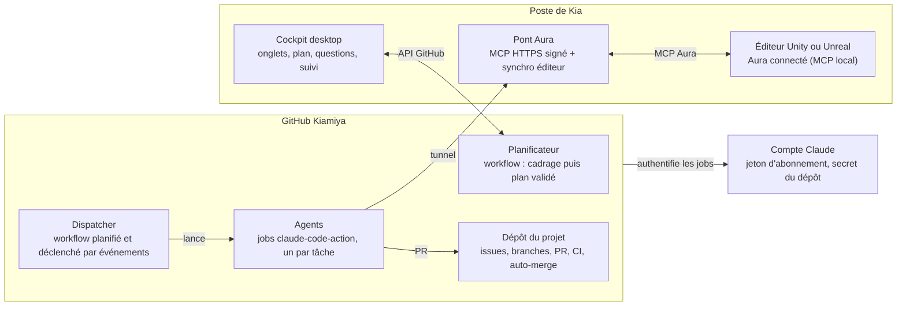
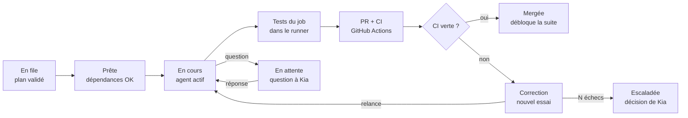

# AgentLake — Cadrage de l'orchestrateur de projets multi-agents

Nov 5, 2026 · @Kia

## Vision et périmètre

AgentLake transforme un brief ou un GDD en plan validé, puis le fait réaliser par des agents Claude Code qui tournent dans GitHub Actions ; le merge sur `main` est automatique dès que toute la CI est verte.

Utilisateur unique : Kia. Le pilotage se fait dans un cockpit desktop à onglets, un par projet. Aucun agent ne tourne sur le poste ; seul le pont vers Aura y vit, pour les tâches de jeu.

Ce que fait le système, dans l'ordre :

1. Importer un brief (docx, html, md, pdf, txt) ou un GDD, plus des pièces de contexte (images, maquettes, annexes) ; le cockpit les normalise et les verse dans le dépôt du projet sous `.agentlake/context/`.
2. Lancer le planificateur, un workflow GitHub Actions : il pose ses questions de clarification dans une issue « Cadrage », puis produit un plan validé par schéma.
3. Le plan donne les tâches, leurs dépendances, les profils d'agents, leur nombre et la stratégie de tests.
4. Kia valide le plan dans le cockpit, qui crée une issue GitHub par tâche. Rien ne s'exécute avant.
5. Le dispatcher, un workflow planifié et déclenché par les événements GitHub, lance un job d'agent par tâche prête. L'agent travaille sur sa branche, ouvre une PR, et l'auto-merge s'applique quand tous les checks sont verts.
6. Toute question non couverte par la documentation devient un commentaire structuré sur l'issue et suspend la tâche ; Kia répond depuis le cockpit ou directement sur GitHub.
7. Le cockpit affiche l'avancement en lisant GitHub : kanban, graphe de dépendances, runs et leurs journaux, consommation.

Types de projets couverts : web (React, Supabase, Vercel), jeux Unity et Unreal, mobile, outils internes, scripts et backends divers.

Hors périmètre en V1 : usage multi-utilisateur, déploiement en production automatique (le merge sur `main` est la limite), exécution d'agents sur le poste de Kia.

## Décisions de cadrage

Les treize décisions ci-dessous sont actées et servent de contraintes à toutes les tâches.

| # | Sujet | Décision | Conséquence |
| --- | --- | --- | --- |
| D1 | Cockpit | Application desktop Electron, sans rôle d'exécution | Peut être fermée : les projets avancent sur GitHub, sauf les tâches qui ont besoin du pont Aura |
| D2 | Utilisateurs | Kia seul | Pas d'authentification applicative ni de rôles |
| D3 | Exécution des agents | GitHub Actions avec l'action officielle `anthropics/claude-code-action` | Aucun agent sur le poste ; runners hébergés par GitHub |
| D4 | Accès à Claude | Jeton d'abonnement `CLAUDE_CODE_OAUTH_TOKEN`, généré par `claude setup-token`, stocké en secret de chaque dépôt | Clé API Console envisageable plus tard pour des dépôts d'organisation |
| D5 | Bus d'événements | GitHub : issues, labels, commentaires, PR, checks, runs | État durable sans serveur à maintenir ; le cockpit lit et écrit par l'API |
| D6 | Découpe | Planificateur dans un workflow, plan validé par schéma zod dans le job | Même canal d'exécution que les agents |
| D7 | Autonomie | Validation du plan obligatoire ; ensuite autonomie, sauf questions non couvertes par la documentation | Label d'attente bloquant sur l'issue de la tâche |
| D8 | Dépôts | Compte GitHub Kiamiya, dépôts publics par défaut pour des minutes Actions gratuites et illimitées : un dépôt par projet, plus le dépôt `agentlake` qui héberge les workflows réutilisables | Chaque projet appelle les workflows d'`agentlake` |
| D9 | Merge | Auto-merge GitHub, squash, checks obligatoires dont la relecture par Claude | La qualité repose entièrement sur la CI, exhaustive dès le bootstrap |
| D10 | Jeux vidéo | Aura reste sur le poste ; les agents l'utilisent via un pont MCP sécurisé exposé par le cockpit | Poste allumé et éditeur ouvert pendant les tâches de jeu |
| D11 | Parallélisme | Nombre d'agents calculé par projet, plafonné par des réglages globaux | Groupes de concurrence GitHub Actions pour les ressources exclusives |
| D12 | Types de projets | Web, jeux Unity/Unreal, mobile, outils internes, scripts, backends | Profils qualité et gabarits CI par type |
| D13 | Livrables de la découpe | Ce document + des fichiers Markdown prêts à poser dans le dépôt | `CLAUDE.md` + `tasks/*.md` fournis à part |

Hypothèse de travail : poste principal sous Windows (Unity et Unreal), avec compatibilité macOS conservée dans le code.

## Reprise de l'agent lake PRIF

AgentLake reprend les principes éprouvés de l'agent lake PRIF (commit `651a65c`) : suspendre et reprendre un travail sur événement, ports et adaptateurs injectés, garde-fous codés plutôt que promptés. Comme les agents tournent dans GitHub Actions, c'est GitHub qui porte l'état durable, à la place des checkpoints LangGraph.

### Ce qu'on reprend

| Pattern PRIF | Où dans le PRIF | Reprise dans AgentLake |
| --- | --- | --- |
| `interrupt()` puis reprise par `Command({ resume })` | `prif-gateway/src/graph.ts`, `gateway.ts` | Une question bloquante pose un label d'attente et termine le job ; la réponse relance un job qui repart de l'issue et de la branche |
| Checkpoints sur SQLite (`SqliteSaver`) | `prif-gateway/src/main.ts` | État durable dans GitHub : issue, labels, branche, PR, commentaires |
| Ports et adaptateurs, objet runtime, doublures dans `test-utils.ts` | `orchestrator/src/runtime.ts` | Même découpage dans le dispatcher, le planificateur et le cockpit ; GitHub, Claude et Aura derrière des ports |
| Verrou par clé (`withTicketLock`) | `prif-gateway/src/gateway.ts` | Groupes de concurrence GitHub Actions, par tâche et par ressource exclusive |
| Reprise seulement si le fil attend ce type d'événement ; le reste est ignoré et tracé | `resumeIfWaiting` | Une réponse ne relance l'agent que si l'issue porte le label d'attente et l'identifiant de cette question |
| Veilleur des attentes avec délais | `startWaitWatcher` | Dispatcher planifié toutes les 10 minutes en plus des déclencheurs d'événements |
| Garde-fous dans le code (questions, tentatives) | `feature-requests.ts`, `qualify` | Tentatives, quotas et permissions des jobs appliqués par le dispatcher et les workflows |
| Dégradation explicite (DEGRADE) | `prif-gateway/src/main.ts` | Statut par intégration dans le cockpit : API GitHub, jeton Claude, pont Aura |
| Monorepo npm workspaces + dependency-cruiser en CI | `.dependency-cruiser.cjs` | Mêmes outils et règles de dépendances entre paquets |
| Tests d'intégration séparés | `vitest.integration.config.ts` | Même séparation : CI rapide sans réseau, intégrations réelles à part |
| Secrets comparés à temps constant, services sur 127.0.0.1 | `shared/src/secrets.ts` | Pont Aura sur 127.0.0.1 derrière le tunnel, jetons signés vérifiés à temps constant |

### Dettes PRIF à ne pas reproduire

| Dette constatée dans le PRIF | Parade dans AgentLake |
| --- | --- |
| Accusé de réception avant traitement : une erreur perd l'événement | Événements portés par GitHub ; dispatcher idempotent, rejouable, avec passe planifiée de rattrapage |
| Aucune relance ni délai sur les appels sortants | Timeout sur chaque job, relances avec backoff sur l'API GitHub et le pont, tentatives d'agent bornées |
| Verrous et activité en mémoire | Aucun état critique en mémoire : tout est dans GitHub ou dans un cache local reconstructible |
| Modèle Claude codé en dur | Modèle par profil dans `.agentlake/profiles/` |
| JSON libre parsé à la main | Plan écrit dans `.agentlake/plan.json`, validé par zod dans le job, erreurs renvoyées au modèle |
| Deux graphes qui dupliquent la même logique | Un seul workflow d'agent réutilisable, paramétré par profil |
| Tables créées à la volée | Cache local du cockpit uniquement par migrations Drizzle |
| Premier passage tardif d'un planificateur | Dispatcher déclenché à chaque événement et en cron |
| Sauvegardes à planifier à l'extérieur | Rien à sauvegarder côté poste : le cache se reconstruit depuis GitHub |

## Architecture technique

Le système se répartit en trois zones : GitHub, où tout s'exécute et où vit l'état ; le cockpit desktop, qui pilote et affiche ; le poste de Kia, qui n'héberge que l'éditeur et Aura, joints aux agents par un pont MCP.



Le cockpit peut être fermé sans arrêter les projets ; seul le pont Aura doit tourner pendant les tâches de jeu.

Stack : monorepo npm workspaces en TypeScript strict (ESM). Côté GitHub : GitHub Actions, `anthropics/claude-code-action`, workflows réutilisables, scripts Node pour le dispatcher et le validateur de plan. Côté cockpit : Electron + electron-vite, React 18, Tailwind, shadcn/ui, Zustand, TanStack Query, Octokit, better-sqlite3 + Drizzle pour le cache, mammoth, pdf-parse et turndown pour l'ingestion. Côté pont : SDK MCP TypeScript et un tunnel HTTPS. Partout : zod pour les contrats, Vitest, Playwright, dependency-cruiser.

Paquets du monorepo `agentlake`, sur le modèle du PRIF :

| Paquet | Contenu | Peut dépendre de |
| --- | --- | --- |
| `shared` | Schémas zod : plan, format d'issue de tâche, labels d'état, protocole de questions, config de projet | rien |
| `github` | Port GitHub et adaptateur Octokit avec relances, doublure de test | shared |
| `planner` | Prompts versionnés, validateur de plan, script exécuté dans le job de planification | shared, github |
| `dispatcher` | Sélection des tâches prêtes, calcul de capacité, lancement des jobs, gestion des tentatives | shared, github |
| `aura-bridge` | Pont MCP vers Aura : transport HTTP, authentification, liste blanche, synchronisation de l'éditeur | shared |
| `desktop` | Cockpit Electron : processus principal, preload, renderer React | shared, github, aura-bridge |
| `.github/workflows/` | Workflows réutilisables : `planner.yml`, `agent-task.yml`, `review.yml`, `dispatcher.yml` | appellent les scripts des paquets |

dependency-cruiser bloque en CI toute dépendance hors de ce tableau ; seul `desktop` connaît Electron.

Flux principal : import du brief dans le cockpit → commit dans `.agentlake/context/` → workflow de planification (questions dans l'issue « Cadrage », puis plan validé) → validation par Kia → une issue par tâche → dispatcher → jobs d'agents sur leurs branches → PR → CI et relecture → auto-merge → le dispatcher débloque les tâches suivantes.

## Modèle de données

GitHub est la source de vérité ; le cockpit ne garde qu'un cache SQLite reconstructible et ses réglages.

| Élément | Où il vit | Contenu |
| --- | --- | --- |
| Projet | Dépôt GitHub + `.agentlake/project.yml` | Type, profil qualité, plafonds d'agents, profils retenus |
| Contexte | `.agentlake/context/` (images en Git LFS) | Brief et annexes normalisés en Markdown, images |
| Plan | `.agentlake/plan.json`, versions dans l'historique git | Plan validé par Kia |
| Tâche | Issue GitHub avec le label `agentlake:task` | Corps structuré : objectif, critères, tests exigés, profil, dépendances |
| Dépendances | Relations de dépendance natives de GitHub si le compte les propose, sinon section « Dépend de » du corps de l'issue | Lues par le dispatcher |
| État de tâche | Labels `agentlake:state/*` | queued, ready, running, awaiting-answer, waiting-editor, fixing, escalated ; une tâche mergée = issue fermée par sa PR |
| Question | Commentaire d'issue avec un bloc structuré | Identifiant, texte, options, bloquante ou non |
| Réponse | Commentaire qui cite l'identifiant de la question | Écrit par le cockpit ou à la main sur GitHub |
| Décisions | `.agentlake/decisions.md` | Réponses promues, lues par tous les agents suivants |
| Run | Exécution GitHub Actions | Journaux, durée, conclusion, tentative, lien vers l'issue |
| Cache du cockpit | SQLite local (better-sqlite3 + Drizzle, migrations) | Projets ouverts, onglets, réglages, miroir des issues et runs pour l'affichage |
| Secrets | `safeStorage` pour le jeton GitHub ; secrets GitHub pour `CLAUDE_CODE_OAUTH_TOKEN` et `AURA_BRIDGE_SECRET` | Jamais en clair, jamais en base |

## Agents

Un agent est un job GitHub Actions qui exécute `claude-code-action` avec un profil, sur une tâche, dans une branche dédiée ; les profils sont des fichiers versionnés dans `.agentlake/profiles/`.

| Profil | Rôle | Outils et MCP | Ressource exclusive |
| --- | --- | --- | --- |
| Architecte | Bootstrap du dépôt, structure, conventions, CI initiale | Fichiers, bash, git | Dépôt entier (première tâche, seule) |
| Frontend | UI web ou desktop, composants, accessibilité | Fichiers, bash, Playwright | Aucune |
| Backend | API, logique métier, intégrations | Fichiers, bash | Aucune |
| Données | Schéma, migrations, RLS Supabase, seeds | Fichiers, bash, CLI Supabase | Migrations (une tâche à la fois) |
| Mobile | Apps React Native ou natives | Fichiers, bash | Aucune |
| DevOps | Workflows, packaging, scripts de build | Fichiers, bash | `.github/` |
| QA | Tests E2E, régression, contrat, couverture | Fichiers, bash, Playwright | Aucune |
| Unity | Gameplay C#, scènes, prefabs, tests EditMode/PlayMode | Fichiers, bash, MCP Aura via le pont | Éditeur Unity du projet |
| Unreal | C++, Blueprints, tests d'automatisation | Fichiers, bash, MCP Aura via le pont | Éditeur Unreal du projet |
| Relecteur | Revue de chaque PR, check obligatoire | Lecture seule, commentaires de PR | Aucune |
| Documentation | README, ADR, docs d'API, guide de jeu | Fichiers | Aucune |

Le planificateur attribue un profil à chaque tâche et propose un nombre d'agents simultanés, que Kia valide avec le plan :

```latex
N = \min(L_{DAG},\ C_{runners},\ C_{global},\ C_{projet})
```

- L\_DAG : largeur maximale du graphe de dépendances, soit le plus grand nombre de tâches exécutables en même temps.
- C\_runners : jobs simultanés permis par GitHub ; les minutes sont gratuites et illimitées en dépôt public, plafonnées à 2 000 par mois en dépôt privé.
- C\_global : plafond fixé dans les réglages pour tous les projets, pour rester dans les limites d'usage de l'abonnement Claude.
- C\_projet : plafond optionnel fixé par Kia pour ce projet.

Les ressources exclusives passent par des groupes de concurrence GitHub Actions : un seul job Unity par projet à la fois, puisqu'un seul éditeur est branché sur Aura.

## Cycle de vie d'une tâche et questions

Chaque tâche est une issue dont les labels portent l'état. Seule une CI entièrement verte mène au merge, et une question bloquante suspend la tâche jusqu'à la réponse de Kia, comme `interrupt()` dans le PRIF.



Un échec de CI relance un job d'agent avec les journaux d'échec en contexte ; après N tentatives (3 par défaut), la tâche passe en escaladée et une question est posée à Kia.

Protocole des questions :

- L'agent publie un commentaire structuré sur l'issue : un en-tête caché `<!-- agentlake:question id=… blocking=true -->`, le texte, le contexte et les options proposées.
- Si la question est bloquante, le job pose le label `agentlake:state/awaiting-answer` et se termine proprement ; aucun runner ne reste occupé pendant l'attente.
- Kia répond depuis le cockpit, ou à la main sur GitHub, par un commentaire `<!-- agentlake:answer id=… -->`. L'événement `issue_comment` déclenche le dispatcher, qui relance l'agent seulement si l'issue attend cette question précise et si l'auteur du commentaire est le propriétaire du dépôt.
- Une case « décision du projet », cochée par défaut, ajoute la réponse à `.agentlake/decisions.md` par commit ; tous les agents suivants la lisent.
- Une question non bloquante laisse l'agent continuer avec un choix par défaut, signalé dans la PR.
- Le cockpit notifie Kia (badge d'onglet et notification système) ; GitHub notifie aussi par mail et sur mobile.

## Stratégie qualité

Le merge automatique n'est sûr que si la CI est exigeante : chaque projet généré démarre avec un profil qualité complet, et AgentLake lui-même est construit avec le même niveau d'exigence.

### Règles communes à tous les projets générés

- Chaque tâche livre son code et ses tests dans la même PR ; une PR sans test pour du code applicatif est refusée par le relecteur.
- Checks obligatoires sur `main` : lint, vérification de types, tests unitaires, tests d'intégration, build, audit de dépendances, détection de secrets (gitleaks), analyse statique (CodeQL).
- Seuils de couverture : 80 % des lignes sur le code métier, sans baisse par rapport à `main`.
- Régression : la suite complète tourne sur chaque PR et chaque merge ; tout bug corrigé ajoute un test qui le reproduit.
- Un agent ne peut pas désactiver, sauter ou affaiblir un test existant sans question bloquante à Kia.

### Profils par type de projet

| Type | Unitaires | Intégration et contrat | E2E et régression | Spécifique |
| --- | --- | --- | --- | --- |
| Web React/Supabase | Vitest, Testing Library | Supabase local dans le runner, pgTAP pour RLS | Playwright, captures de régression visuelle | Accessibilité (axe), Lighthouse en CI |
| Backend | Vitest ou Jest, pytest selon la stack | Testcontainers, tests de contrat d'API (OpenAPI) | Scénarios de bout en bout sur l'API | Tests de charge légers (k6) aux jalons |
| Mobile | Jest | Modules natifs mockés | Maestro | Build Android et iOS en CI |
| Outils et scripts | Vitest ou pytest | Fichiers fixtures réels | Tests de CLI de bout en bout | Sorties de référence comparées |
| Unity | Unity Test Framework, EditMode | PlayMode | Scènes de test automatisées, build joueur | GameCI sur runners GitHub, licence Unity en secret |
| Unreal | Automation Spec | Functional Tests | Gauntlet | Tests lancés via le pont sur l'éditeur local et publiés comme check GitHub (voir points ouverts) |

### Tests d'AgentLake lui-même

- Unitaires (Vitest) : schémas partagés, dispatcher (tâches prêtes, capacité, idempotence, tentatives), validateur de plan, protocole de questions, pont Aura (signature, liste blanche).
- Intégration : API GitHub simulée (msw) ; workflows vérifiés par actionlint ; pont contre un faux serveur MCP Aura ; cache SQLite réel.
- E2E (Playwright pour Electron) : parcours du cockpit contre un GitHub simulé.
- Régression : briefs de référence, plans attendus et séquences d'événements GitHub rejouées à chaque PR.
- Bac à sable `@live`, hors CI : un dépôt de test Kiamiya où tout le cycle tourne pour de vrai, lancé à la main ou chaque nuit.
- CI GitHub Actions sur Windows et macOS pour le cockpit, Linux pour le reste.

## Intégrations

Trois intégrations, chacune derrière un port testable : GitHub Actions avec l'action Claude Code pour exécuter, l'API GitHub pour l'état, le pont Aura pour les éditeurs.

### Claude Code dans GitHub Actions

- Le dépôt `agentlake` héberge les workflows réutilisables `planner.yml`, `agent-task.yml`, `review.yml` et `dispatcher.yml` ; chaque projet reçoit au bootstrap de petits workflows qui les appellent.
- Selon la [documentation officielle](https://code.claude.com/docs/en/github-actions), le secret `CLAUDE_CODE_OAUTH_TOKEN` authentifie l'action avec l'abonnement Claude ; il se génère avec `claude setup-token`. Le jeton est lié à l'abonnement de Kia : pour un dépôt d'organisation, la doc recommande plutôt une clé API de la Console.
- Chaque job reçoit le profil (prompt système, outils autorisés, nombre maximal de tours, modèle), le corps de l'issue, le contexte `.agentlake/` et des permissions GitHub minimales.
- Timeout par job ; transcription de session et journaux conservés en artefacts, liés depuis l'issue.
- Le plan est écrit par le planificateur dans `.agentlake/plan.json`, puis validé par un script zod dans le même job ; en cas d'erreurs, le job relance Claude avec la liste des erreurs, 3 fois au plus.

### API GitHub

- Octokit, jeton à granularité fine stocké dans le coffre du système.
- Bootstrap d'un projet : création du dépôt, protection de `main`, checks obligatoires, auto-merge, labels `agentlake:*`, secrets chiffrés avec la clé publique du dépôt, workflows d'appel.
- Le cockpit écrit les fichiers de contexte, le plan validé, les issues et les réponses ; il lit les issues, PR, runs et checks par sondage toutes les 30 secondes quand il est ouvert.

### Pont Aura

- Le cockpit lance le serveur MCP d'Aura (`aura-unity` ou `aura`, commande copiée depuis l'écran « MCP Configuration » d'Aura) et le réexpose en HTTP MCP sur 127.0.0.1, publié par un tunnel HTTPS (Tailscale Funnel par défaut, gratuit). Aura Pro, Unity, Unreal et le cockpit tournent sur le poste de Kia.
- Authentification : jeton signé HMAC avec le secret partagé `AURA_BRIDGE_SECRET`, contenant l'identifiant du run et une expiration courte, vérifié à temps constant. Liste blanche des outils Aura autorisés, journal d'audit, interrupteur d'arrêt dans le cockpit.
- Synchronisation : l'éditeur est ouvert sur un clone dédié du dépôt, distinct de la copie de travail de Kia. Le pont ajoute trois outils : `editor_checkout` (récupère la branche de la tâche et attend la fin de l'import), `editor_commit_push` (commite scènes, prefabs et `.meta`, puis pousse), `editor_status`.
- Séquence d'un agent de jeu : il pousse son code, appelle `editor_checkout`, utilise les outils Aura, appelle `editor_commit_push`, récupère la branche dans le runner, puis lance les tests.
- Santé : le dispatcher interroge le pont avant toute tâche de jeu. Pont absent ou éditeur fermé : label `agentlake:state/waiting-editor` et notification « Ouvre Unity sur le projet X » ; les autres tâches continuent.

## Plan de réalisation

24 tâches réparties en 4 jalons ; chaque jalon se termine par une version utilisable. Chaque tâche a son fichier `tasks/Txx-*.md` avec objectif, spécifications, critères d'acceptation et tests exigés.

- **J1 — Du brief au plan validé** (T00 à T10) : cockpit, ingestion, bootstrap des dépôts, planificateur dans Actions, revue et validation du plan.
- **J2 — Exécution cloud** (T11 à T16) : profils, dispatcher, questions, porte qualité avec merge auto, suivi dans le cockpit. À partir de là, AgentLake peut construire ses propres tâches suivantes.
- **J3 — Jeux vidéo** (T17 à T20) : pont Aura, tunnel, synchronisation de l'éditeur, profils Unity et Unreal.
- **J4 — Robustesse et livraison** (T21 à T23) : idempotence, garde-fous, E2E complet, packaging.

| ID | Tâche | Jalon | Dépend de |
| --- | --- | --- | --- |
| T00 | Socle du monorepo : paquets, TypeScript strict, Vitest unitaire et intégration, dependency-cruiser, CI | J1 | — |
| T01 | Schémas partagés : plan, issue de tâche, labels d'état, protocole de questions, config de projet | J1 | T00 |
| T02 | Port et adaptateur GitHub : dépôts, issues, labels, commentaires, PR, checks, secrets, workflows | J1 | T01 |
| T03 | Socle du cockpit : Electron, IPC typé, cache SQLite, coffre de secrets, réglages | J1 | T00 |
| T04 | Coque du cockpit et système d'onglets | J1 | T03 |
| T05 | Création de projet et bootstrap du dépôt GitHub | J1 | T02, T04 |
| T06 | Ingestion des documents et versement dans `.agentlake/context/` | J1 | T02, T03 |
| T07 | Bibliothèque de contexte dans le cockpit | J1 | T05, T06 |
| T08 | Workflows réutilisables de base et workflow d'agent `agent-task.yml` | J1 | T01 |
| T09 | Planificateur : workflow, prompts, validateur de plan, issue « Cadrage » | J1 | T06, T08 |
| T10 | Revue et validation du plan, création des issues | J1 | T04, T09 |
| T11 | Profils d'agents versionnés | J2 | T08 |
| T12 | Dispatcher : tâches prêtes, capacité, concurrence, tentatives | J2 | T10, T11 |
| T13 | Protocole de questions et décisions | J2 | T12 |
| T14 | Porte qualité : profils qualité, gabarits CI, relecteur, boucle de correction, auto-merge | J2 | T12 |
| T15 | Boîte de questions et notifications du cockpit | J2 | T13 |
| T16 | Tableau de bord d'avancement et journaux des runs | J2 | T12 |
| T17 | Pont Aura : transport HTTP, signature, liste blanche, audit | J3 | T03 |
| T18 | Tunnel, santé du pont et interrupteur d'arrêt | J3 | T17 |
| T19 | Synchronisation de l'éditeur : clone dédié, checkout, commit et push | J3 | T17 |
| T20 | Profils Unity et Unreal, GameCI, intégration au dispatcher | J3 | T14, T18, T19 |
| T21 | Robustesse : idempotence, rattrapage, garde-fous de permissions | J4 | T14 |
| T22 | Suite E2E complète et bibliothèque de régression | J4 | T15, T16, T21 |
| T23 | Packaging du cockpit et documentation | J4 | T22 |

## Risques et points ouverts

Les deux risques principaux sont l'ouverture des dépôts publics à des tiers et l'exposition du pont Aura ; viennent ensuite la qualité de la CI et les limites d'usage du compte Claude.

| Risque | Impact | Parade prévue |
| --- | --- | --- |
| Dépôts publics : n'importe qui peut ouvrir une issue, commenter ou proposer une PR | Agent déclenché par un tiers, injection de prompt, consommation du quota Claude | Seuls les événements dont l'auteur est le propriétaire du dépôt sont traités ; approbation obligatoire des workflows venant de forks ; aucun secret exposé aux PR de forks ; claude-code-action réservé aux comptes ayant le droit d'écriture |
| Contexte et code visibles de tous | Fuite d'un brief client ou d'un GDD non annoncé | Option « dépôt privé » par projet dans l'assistant de création (2 000 minutes par mois incluses) ; avertissement avant tout versement de contexte dans un dépôt public |
| Limites d'usage de l'abonnement Claude, jeton lié à Kia | Agents en attente, projets ralentis | Plafond global, rattrapage par le dispatcher planifié ; clé API Console pour les dépôts d'organisation |
| Pont Aura exposé sur Internet | Exécution de scripts éditeur par un tiers | Tunnel avec contrôle d'accès, jetons signés à courte durée, liste blanche d'outils, pont actif seulement pendant les tâches de jeu, interrupteur |
| Poste éteint ou éditeur fermé | Tâches de jeu bloquées | Label `waiting-editor` et notification ; les autres tâches continuent |
| Conflits entre l'éditeur et le runner (scènes, `.meta`) | Scènes corrompues ou PR en conflit | Un seul agent de jeu par projet, synchronisation par commits explicites, Git LFS, sérialisation texte forcée |
| CI trop faible au démarrage d'un projet | Code non testé mergé | Bootstrap obligatoire avec tous les checks avant toute autre tâche ; relecteur Claude en check obligatoire |
| Agent qui « triche » sur les tests | Faux vert | Toute modification de tests existants déclenche une question bloquante ; diff des tests vérifié par le relecteur |
| Conflits entre branches parallèles | Relances coûteuses | Découpe par zones de code, ressources exclusives, mise à jour de branche automatique |

Points ouverts à trancher pendant J1 :

- [ ] Compte GitHub : Kiamiya pour tous les projets, ou une organisation DMH pour les projets clients (ce qui impose une clé API Console) ?
- [ ] Projets clients confidentiels : lesquels passent en dépôt privé (2 000 minutes par mois incluses) ?
- [ ] Tunnel du pont : Tailscale Funnel par défaut (gratuit, sans domaine), Cloudflare Tunnel en alternative.
- [ ] Unreal : tests via le pont sur l'éditeur local, ou runner auto-hébergé sur une VM.
- [ ] Modèle Claude par profil.

## Mode d'emploi pour Claude Code

Posez `CLAUDE.md`, le dossier `tasks/` et ce document exporté en `docs/cadrage.md` à la racine d'un dépôt vide `agentlake`, puis donnez les tâches une par une dans l'ordre du tableau.

1. Créer le dépôt `agentlake` sur GitHub (Kiamiya), y copier les fichiers.
2. Pour J1, faire réaliser chaque tâche par Claude Code avec le prompt type de `tasks/README.md`, une PR par tâche.
3. Relire la PR et la CI, merger, puis passer à la tâche suivante dont les dépendances sont mergées.
4. Les tâches sans dépendance commune (T02 et T03, ou T06 et T08) peuvent avancer en parallèle.
5. À la fin de J1, tester sur un vrai brief, par exemple le GDD du RPG SF low-tech. Après J2, les tâches J3 et J4 peuvent être confiées à AgentLake lui-même.

Chaque fichier de tâche suit le même gabarit : objectif, contexte, dépendances, périmètre, spécifications, critères d'acceptation, tests exigés, définition de terminé, hors périmètre.
